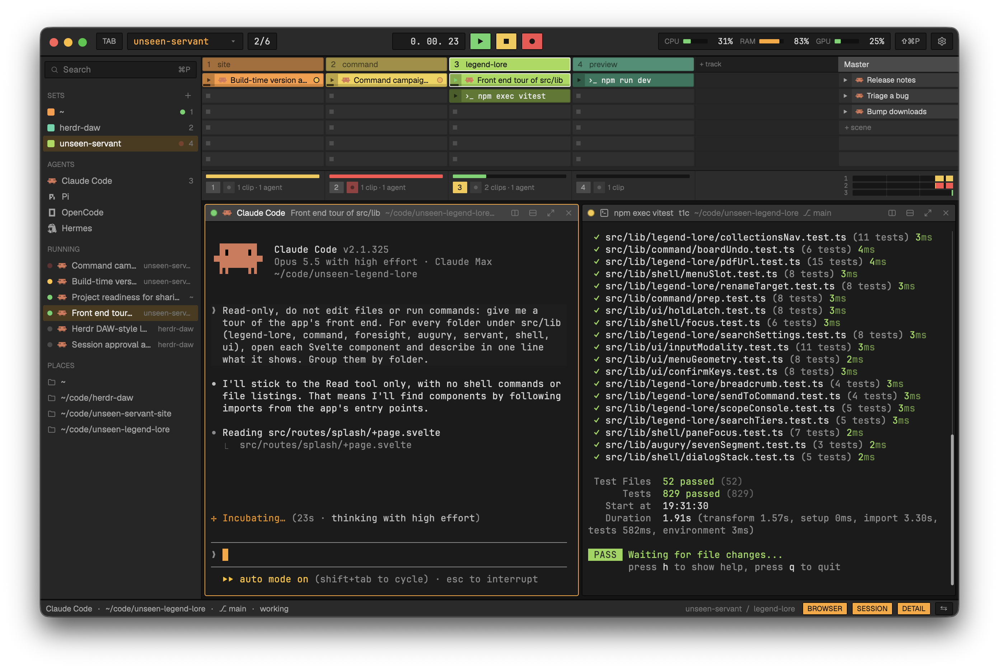

# Herdr Studio

An Ableton Live–style layout for [Herdr](https://herdr.dev). A space is a Live Set, its tabs are tracks, and each pane is a clip: an agent or a terminal, like MIDI and audio clips. The transport's play, stop and record buttons light up when agents are working, finished or need you. Saved task scenes launch an agent with its first message, and the Master meter shows the last 30 minutes of every agent's activity.



## Install

Ask your agent to add it from this repo (`herdr-app --skill` explains how), or copy the files into your Herdr home (`~/.config/herdr-app`):

```sh
HOME_DIR="${HERDR_APP_HOME:-$HOME/.config/herdr-app}"
cp layouts/daw.json layouts/daw.svg "$HOME_DIR/layouts/"
cp themes/daw.json "$HOME_DIR/themes/"
cp -R mods/daw "$HOME_DIR/mods/"
```

Then switch to it with **Cmd-Shift-L** on macOS (Ctrl-Shift-L elsewhere) or from Settings. Your other layouts are untouched. To remove it, delete those files.

[`mods/daw/README.md`](mods/daw/README.md) is the user guide: what every button does, task scenes, activity lanes and context strips.

## What it runs and reads

It makes no network requests and writes nothing outside Herdr's own storage.

- **Meters**: `ps` every 3 s for CPU; `vm_stat` (macOS) or `/proc/meminfo` for RAM; `ioreg` (macOS) or `nvidia-smi` for GPU, hidden when neither reports anything.
- **Context strips** (read-only, local agents only): Claude Code's session files and logs under `~/.claude/`, and OpenCode's database and model list under `~/.local/share/opencode/` and `~/.cache/opencode/`, through the `sqlite3` CLI.

## How it's built

[`RECIPE.md`](RECIPE.md) describes the layout region by region: what each part shows, how it reacts to agent status, and how it's built. An agent can rebuild it from scratch from that file.

## Working on it

Edit the layout where Herdr runs it (`~/.config/herdr-app`, where it reloads live), then run `./sync.sh` to copy the shipped files back into this repo. It skips the mod's generated typings and never copies your data, and it ends with `git status` instead of committing.

## License

[Apache-2.0](LICENSE)
