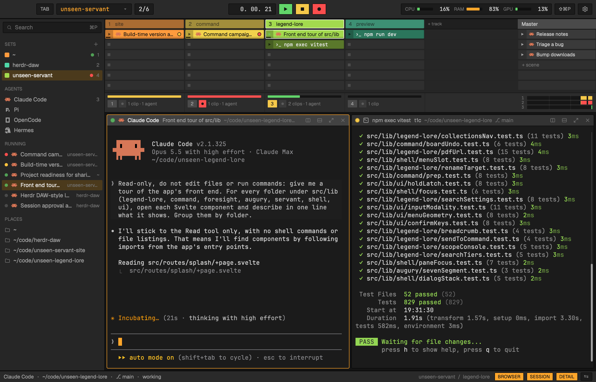

# Herdr Studio

A Herdr layout drawn like Ableton Live's Session View. The shown space is the Live Set, its tabs are tracks, and each pane is a clip: an agent clip (like MIDI) or a terminal clip (like audio). A transport bar's play, stop and record buttons light up when agents are working, finished or need you. The Master column holds task scenes (an agent plus its first message), and the Master mixer cell draws each agent's last 30 minutes as activity lanes. The shown track's panes sit underneath as "devices", each with its own title bar. It's dark charcoal throughout, with amber highlights.

## What you see

Top to bottom, in a `column`:

1. **Transport bar** (40 px, `#2a2a2a`, drags the window). On macOS without a system title bar it leaves 78 px on the left for the traffic lights.
   - Left: a `TAB` button, an LCD with the shown space's name (amber `#ffa62b`, JetBrains Mono 12.5, 128 px, ▾ caret) and an LCD reading `working/total` agents.
   - Center: a position LCD showing how long the shown space has been working (`h. mm. ss`, from its tabs' earliest `working_since`; `1. 1. 1` when idle). Next to it are three 30×24 transport buttons: ▶ play, ■ stop and ● record.
   - Right: a load LCD with CPU, RAM and GPU meters (label, a 34×6 bar, a percentage; GPU is left out when nothing reports it), an LCD with the palette's shortcut as bound in `keys.json`, and a settings gear. Minimize, maximize and close buttons appear only where the system draws no window buttons.
   - The LCDs are recessed boxes: `#1c1c1c` fill, `#0d0d0d` 1 px edge, 2 px radius, 24 px tall.
2. **Body**, a `row`:
   - **Browser** (224 px, 170–420, `#262626`). It has a Search box showing the picker's shortcut, then small-caps section labels (10 px, `#727272`) for **Sets**, **Agents**, **Running** and **Places**. Rows are 22 px, with the selected row in `#4b3a1c`.
     - Set rows: a 10 px color square, the name, a status LED and the tab count.
     - Agent rows: the agents installed where the shown Set lives (program icon, name, and how many run in this Set).
     - Running rows: an LED, the program icon, the agent's title, a pinned ● dot and the space name.
     - Places: up to 10 folders.
   - **Views**, a `column`:
     - **Session grid** (236 px, 120–1600, `#262626`).
       - A 22 px header row: one track header per tab of the shown space, in its clip color, showing the tab's number and, once named, its name. The shown tab has a white outline at full opacity; the others are at 62 %. Then a 96 px "+ track" drop zone, and a 168 px **Master** header on the right.
       - 22 px clip rows below: one clip per pane, top to bottom in pane order. Agent clips are filled with the track color and show the program icon and the agent's session title in dark ink. Terminal clips are the track color at 55 % brightness with a `›_` mark and the command in mono. Every clip starts with a dark launch triangle. Empty slots are `#2f2f2f` with a small stop square. The Master column holds one task scene per row, then "+ scene".
       - Claude Code and OpenCode clips carry a 3 px context strip along their bottom edge: how full the agent's context window is, red past 80 %.
       - At the bottom, a 42 px mixer strip. Each track has a meter, a numbered activator (yellow when shown) and an arm button. Master holds the activity lanes.
       - Columns are 64–172 px wide, sharing the width. Clip colors cycle by tab number: `#ff9b3d #f2d24c #a3da4e #4fd6a8 #4cc2ef #7f9dff #b98cf2 #f27bbd #ff6b66 #c9a77a`.
     - **Detail**: the shown tab's terminals on `#141414` with 4 px padding. Each pane is a card: 3 px radius, `#080808` border and an amber border when focused, with 4 px gaps. Every pane has a 24 px **device header** on top, even when it's the only pane.
3. **Status bar** (24 px, `#2a2a2a`).
   - Left: the focused terminal's program · folder · ⎇ branch · status.
   - Right: `space / tab`, then the toggles `BROWSER`, `SESSION`, `DETAIL` and `⇆`. A toggle is amber with dark ink when on, a recessed box when off.
4. **Scene editor**: a 460×420 dialog over the window (the same mod, role `scene`) with a Name field, the installed agents as chips, a Task text area (the agent's first message), and Delete, Cancel and Save.

Look: theme `daw` (`themes/daw.json`): terminal background `#1b1b1b`, text `#d6d6d6`, accent `#ffa62b`, selection `#5a4622`. The rest of the look is set on the layout root:
- UI font Geist, terminal font size 13 and terminal padding 8×8. Geist and JetBrains Mono ship with Herdr.
- Window background `#0f0f0f` and 1 px dividers in `#0c0c0c`.
- No system title bar; traffic lights at 12,13.

## How it behaves

Agent status shows everywhere with the same colors:

| | Color | Motion |
|---|---|---|
| **working** | green `#62d56a` | LEDs pulse (900 ms); the clip's launch triangle pulses green; the mixer meter sweeps |
| **blocked** | red `#ff4f4f` | LEDs and dots pulse (600 ms); ● record pulses (700 ms); the device header shows `NEEDS YOU` |
| **done** | amber-yellow (`#ffc23d` in the theme, `#f5c84a` in the transport and mixer) | steady dot on the clip; the device header shows `DONE` |
| **idle** | grey `#6a6a6a` / `#7a7a7a` | no LED in the lists |

A plain terminal's device activator is yellow.

- **Transport**
  - `TAB`: a new tab in the shown space.
  - Space LCD: opens the picker.
  - `working/total` LCD: `agent.next`.
  - ▶, ■ and ●: lit while any agent is working, done or blocked. Each click focuses the next agent in that state, cycling.
  - Meters: sampled every 3 s. Green, amber above 60 %, red above 85 %. The tooltip gives RAM in GB.
  - Palette LCD: the palette. Gear: settings.
- **Browser**
  - Search: opens the picker.
  - Sets: click shows the space, double-click renames it, + makes a new one.
  - Agents: click starts the agent as a new track (`tab.new` with its command, named after it); ⌥-click (Alt-click) adds it as a clip, splitting right beside the focused pane of the shown track. The list comes from `knownAgents` for the Set's machine, shown at once from the + menu's cache (shared `new-menu.agents`) and checked again every minute.
  - Running: sorted blocked → done → working → idle. This order is also what `agent.next` / `agent.prev` follow (`setAgentOrder`). Click focuses an agent.
  - Places: live terminal folders, then space folders, then home. Click opens a new tab there.
- **Session grid**
  - Track headers: click shows the tab, double-click renames it, right-click opens Herdr's tab menu.
  - Clips: click shows the tab and focuses the pane, double-click zooms it, right-click opens Herdr's terminal menu. The focused pane of the shown tab has a white outline; a zoomed one shows `Z`.
  - Clip text: an agent's session title (its terminal title without leading status glyphs), else the program; the tooltip has both, plus the context reading.
  - The empty slot right under a track's last clip: double-click splits a new terminal clip. "+ track": double-click makes a new tab.
  - Mixer: the meter shows the track's most urgent clip (full red, full yellow, or a green sweep that grows with the number working). The activator shows the tab. The arm button pulses red when a clip there needs you and jumps to it. Then `N clips · M agents`.
  - Master scenes: ▶ starts a new track named after the scene, running its agent with its task (`tab.new` with `argv` and `task`). The triangle is green while a tab of that name is working, with a red or amber dot when one needs you or finished. Double-click a scene to edit it; "+ scene" adds one. Scenes are saved per space in shared `daw.scenes`. A scene whose agent isn't installed where the Set lives is dimmed and won't launch.
  - Activity lanes: one lane per agent of the shown Set while there are 5 or fewer, else one per track (its agents merged, most urgent status wins). Lanes that don't fit merge into a last `+` row. Now is the right edge, faint gridlines mark every 10 minutes, and each lane carries its track number when tall enough. The tooltip totals each lane's time per status.
- **Scene editor**: Enter in Name saves, ⌘↩ (Ctrl+Enter) in Task saves, Esc closes. Save needs a name.
- **Device header**
  - Contents: activator, program icon, name (bold), title, folder and branch, status badges (and `ZOOM` when zoomed), then split right, split down, zoom/unzoom and close.
  - Background `#424242` when focused, `#333333` otherwise.
  - Click focuses the pane, double-click zooms it.
- **Status bar toggles**: show or hide browser, session and detail; `⇆` switches layouts. Hiding Detail lets the grid take the full height, and showing it again restores the grid's previous height.

## Built from

- **Layout** `layouts/daw.json`: `column` root → `transport` block, `body` row (`browser` block, `views` column with `session` block and `detail` tab block), `statusbar` block. Every block is one mod, `daw`, given `props: { role }`: `transport`, `browser`, `session`, `device` (the pane header) or `status`; `scene` is the dialog the grid opens. The session block also takes an optional `context_window` (tokens) to fix every strip's window. `layouts/daw.svg` is the settings preview.
- **Theme** `themes/daw.json`. It's named like the layout, so it's this layout's own theme.
- **Mod** `mods/daw/` (`mod.json`: `{ "place": "none", "title": "DAW" }`):
  - `main.js` picks a role class from `props().role`, and each role lives in its own file (`transport.js`, `browser.js`, `session.js`, `device.js`, `status.js`, `scene.js`).
  - `kit.js` holds the fixed studio colors, clip colors, LEDs, toggles, shortcut labels, scene storage and helpers.
  - `context.js` reads context figures and windows; `lanes.js` records and draws the activity lanes.
  - The five SVG icons are play, stop, rec, caret and folder.
- **herdr functions**: `spaces`, `agents`, `panes`, `focused`, `props`, `theme`, `layout`, `keys`, `shared` / `setShared` (`space.colors`, `new-menu.agents`, `daw.scenes`), `knownAgents`, `home`, `window`, `run`, `exec`, `hc`, `readTextFile`, `openOverlay`, `closeOverlay`, `setAgentOrder`. From `gpui-base`: `h_flex`, `v_flex`, `InputState` / `Input`, `TextareaState` / `Textarea`.
- **Commands**:
  - Spaces, tabs and agents: `tab.new` (with `name`, `space`, `folder`, `argv`, `task`), `tab.select`, `tab.rename`, `space.new`, `space.select`, `space.rename`, `agent.focus`, `agent.next`.
  - App and panes: `mod.open {name: "picker"}`, `app.palette`, `app.settings`, `pane.split` (with `argv` for agents), `pane.zoom`, `pane.close`, `pane.focus`.
  - Layout: `layout.toggle`, `layout.show`, `layout.hide`, `layout.resize`, `layout.switch`.
  - Window: `window.minimize`, `window.maximize`, `window.close`.
- **Shipped pieces it reuses**:
  - The `menu` mod, for tab and terminal right-clicks.
  - Icons from `mods/workspace-chrome/` (`settings`, `plus`, `search`) and `mods/pane/` (`split-right`, `split-down`, `zoom`, `unzoom`, `close`).
- **Programs**:
  - Meters, every 3 s: `ps -A -o %cpu=` over the core count (`sysctl -n hw.ncpu` or `nproc`, once); RAM from `vm_stat` + `sysctl -n hw.memsize` (app + wired + compressed, as Activity Monitor counts it) or `/proc/meminfo` (total − available); GPU from `ioreg -c IOAccelerator` ("Device Utilization %") or `nvidia-smi`. The first failed GPU reading hides that meter.
  - Context, every 5 s, only for the shown Set's local Claude Code and OpenCode panes:
    - Claude Code: `hc get` gives the pane's foreground pid → `~/.claude/sessions/<pid>.json` gives the session id → the log `~/.claude/projects/*/<id>.jsonl`, of which the last 150 KB are read. The last real reply's `usage` (input + cache read + cache creation) is the context, and its `model` gives the window.
    - OpenCode: `sqlite3 -readonly` on `~/.local/share/opencode/opencode.db`, for the session given with `--session` / `-s`, else the newest top-level session in the pane's folder. The last assistant message's `tokens` (input + cache read + cache write) is the context. Its `providerID` / `modelID` look up the window in `~/.cache/opencode/models.json` (`limit.context`), read by `sqlite3`'s `readfile` so the 5 MB file isn't parsed in the mod.
    - Windows: the layout's `context_window` if set; else Claude models by id (Fable, Mythos, Opus and Sonnet 4.6+, Haiku 5+: 1M; older: 200k); else OpenCode's limit; else 200k. A reading past its window steps the window up to 200k / 256k / 400k / 1M / 2M.
  - No network. It writes only to Herdr's own storage.

## Watch out

- Install `themes/daw.json` along with the layout and mod. Without it the layout falls back to the default theme and the status colors are wrong.
- Most surfaces (bars, panels, LCDs, clips) use fixed colors from `kit.js`, not the theme, so a different theme only changes the terminals, the accent and the status colors.
- The session grid sizes its columns from `on_size_change`, so it starts at 900×236 and settles after the first layout pass.
- The Detail toggle saves the grid's height in the mod's `localStorage` (`session.px`, default 236).
- Activity history lives in the mod's `localStorage` (`lanes`), saved once a minute and on close, and keeps 31 minutes. Herdr keeps no past states, so lanes start empty. They're keyed by terminal address, which Herdr can reuse.
- Set colors in the Browser come from shared `space.colors` (ansi names) when set; otherwise the clip palette cycles by space index.
- Context strips need local agents: Sets on another machine, Pi and Hermes show none. Two OpenCodes in one folder without `--session` can't be told apart.
- At 64 px per track the columns stop shrinking; past roughly a dozen tabs Master is pushed off the right edge.

## Done when

- `herdr-app check mods/daw` passes, and the window can switch to the layout with no error in `herdr-app status`.
- The transport shows the space name in amber, `working/total`, and CPU and RAM percentages within a few seconds.
- Each tab of the shown space appears as a colored track, with one clip per pane. Clicking a clip shows its tab and focuses that pane.
- Starting an agent lights ▶ green, pulses its clip's launch triangle and its LEDs, and fills its track's mixer meter.
- An agent asking for input pulses ● red and shows `NEEDS YOU`. Clicking ● focuses that agent's pane.
- A Claude Code clip grows a context strip within 5 s of its first reply, and its tooltip names the model and window.
- "+ scene" saves a scene; its ▶ opens a new track running that agent with that task.
- `BROWSER`, `SESSION` and `DETAIL` hide and show their regions, and `⇆` switches to the next layout.
